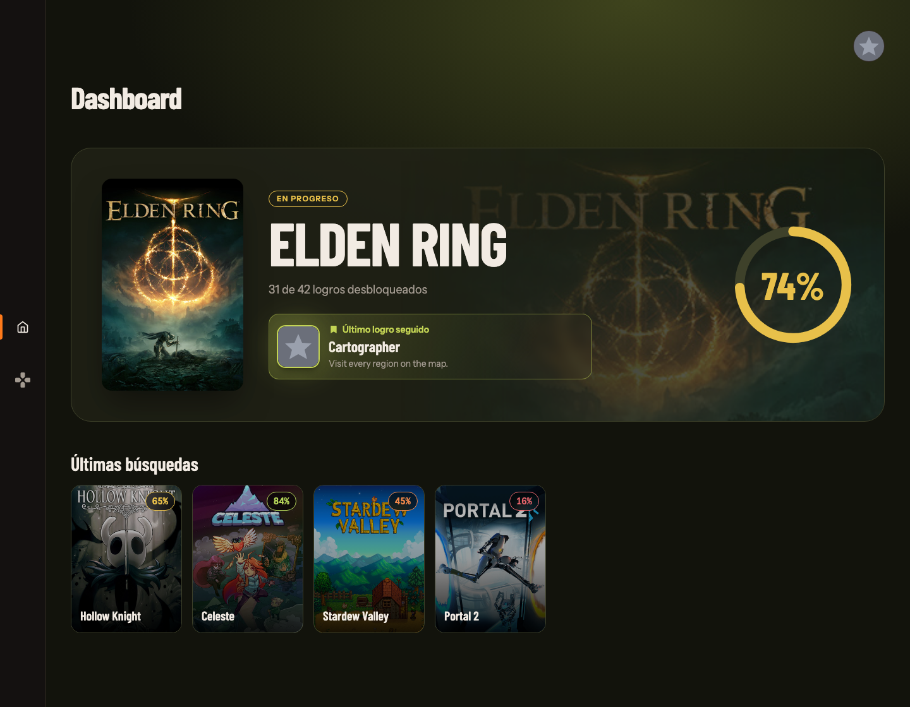

# Trophi

**Español** | [English](README.md)

Todos tus logros de Steam en un mismo sitio. Inicia sesión con Steam, busca en tu biblioteca y mira qué logros te quedan por desbloquear en cada juego.



> **Estado:** en desarrollo. Puedes iniciar sesión con Steam, buscar en tu biblioteca, seguir logros pendientes y guardar juegos.

## Sobre el código

**Stack:** React 19, Vite, Tailwind 4 y TanStack Query en el cliente; Express, TypeScript y MongoDB en el servidor. Todo se ejecuta con Docker Compose.

Aproximadamente la mitad del código actual, la mayor parte del cliente y buena parte de los tests, se ha escrito con Claude Code. La arquitectura, las decisiones de producto, las revisiones y los ADR son de la autora.

## Decisiones clave

Cada decisión está registrada en un ADR; el [índice de ADR](docs/adr/README.md) los agrupa por tema.

- **Cuota de la API de Steam y caché.** Cada instancia usa su propia API key de Steam, y los datos se guardan en MongoDB según lo a menudo que cambian: la biblioteca durante 8 horas, el progreso de logros durante 30 minutos y la lista de logros de cada juego hasta que el progreso revela uno nuevo. El usuario puede refrescar a demanda. ([0002](docs/adr/0002-steam_achievement_sync_cache_strategy.md), [0004](docs/adr/0004-games_library_cache_refresh.md), [0011](docs/adr/0011-cache_de_logros_y_refresco_manual.md))
- **Identidad.** Los métodos de login viven en su propia colección para que sea la base de datos, y no el código, quien garantice que una cuenta de Steam pertenece a un solo usuario. El Steam ID se resuelve una vez por petición en un middleware. ([0001](docs/adr/0001-auth_method_separate_collection.md), [0003](docs/adr/0003-steamid_middleware.md))
- **Datos del usuario.** Los juegos guardados y los logros seguidos se guardan en MongoDB, y el servidor toma el nombre de cada juego de la biblioteca del propio usuario para que no se pueda falsificar. ([0006](docs/adr/0006-juegos_guardados.md), [0007](docs/adr/0007-seguimiento_de_logros_en_mongodb.md))
- **Interfaz.** Las portadas salen del CDN de imágenes de Steam sin ninguna API key extra, cada pantalla se tiñe con los colores del juego actual y los resultados de búsqueda se abren en un `<dialog>` nativo. ([0005](docs/adr/0005-game_covers_steam_cdn.md), [0008](docs/adr/0008-direccion_visual_oscura_y_tinte_por_juego.md), [0009](docs/adr/0009-resultados_de_busqueda_en_dialog_modal.md))
- **Arquitectura.** Los servicios se conectan a mano con inyección por constructor; se valoró un contenedor IoC y se descartó hasta que resuelva un problema real. ([0010](docs/adr/0010-inversion_de_control_descartada.md))

## Ejecutarlo en local

**Requisitos:** [Docker](https://docs.docker.com/get-docker/) con Compose v2 y una [API key de la Web API de Steam](https://steamcommunity.com/dev/apikey).

1. Clona el repositorio:

   ```sh
   git clone git@github.com:thaishdz/Trophi.git
   cd Trophi
   ```

2. Crea `server/src/config/.env`:

   ```sh
   NODE_ENV=development
   PORT=8000
   DATABASE_URI=mongodb://database:27017/<db-name>?replicaSet=rs0
   STEAM_API_KEY=<your-steam-api-key>
   FRONTEND_URL=http://localhost:3000
   BACKEND_URL=http://localhost:8000
   SESSION_SECRET=<any-random-string>
   ```

3. Crea `client/.env`:

   ```sh
   VITE_API_URL=http://localhost:8000/api/v1/
   ```

4. Arráncalo todo:

   ```sh
   docker compose up
   ```

5. Abre [http://localhost:8000/auth/steam](http://localhost:8000/auth/steam) para iniciar sesión y usa la app en [http://localhost:3000](http://localhost:3000).

Páralo con `docker compose down`.

## Documentación

Las decisiones de arquitectura están en [`docs/adr/`](docs/adr/README.md) (con traducción al inglés en [`docs/adr/en/`](docs/adr/en/README.md)) y el flujo de login en [`docs/flows/steam-auth-flow.md`](docs/flows/steam-auth-flow.md).
