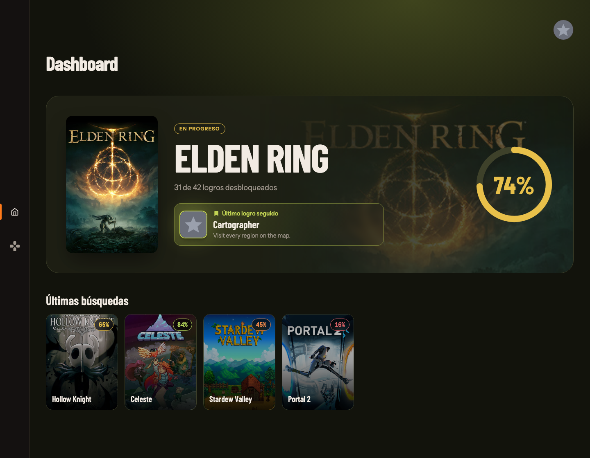

# TrophyLogger

All your Steam achievements in one place. Sign in with Steam, search your library and see which achievements you still have locked in each game.



> **Status:** early development. You can sign in with Steam, search your library, follow locked achievements and save games.

## About the code

**Stack:** React 19, Vite, Tailwind 4 and TanStack Query on the client; Express, TypeScript and MongoDB on the server. Everything runs with Docker Compose.

Roughly half of the current code, most of the client and a large part of the tests, was written with Claude Code. The architecture, the product decisions, the reviews and the ADRs are the author's.

## Run it locally

**Requirements:** [Docker](https://docs.docker.com/get-docker/) with Compose v2 and a [Steam Web API key](https://steamcommunity.com/dev/apikey).

1. Clone the repo:

   ```sh
   git clone git@github.com:thaishdz/TrophyLogger.git
   cd TrophyLogger
   ```

2. Create `server/src/config/.env`:

   ```sh
   NODE_ENV=development
   PORT=8000
   DATABASE_URI=mongodb://database:27017/<db-name>?replicaSet=rs0
   STEAM_API_KEY=<your-steam-api-key>
   FRONTEND_URL=http://localhost:3000
   BACKEND_URL=http://localhost:8000
   SESSION_SECRET=<any-random-string>
   ```

3. Create `client/.env`:

   ```sh
   VITE_API_URL=http://localhost:8000/api/v1/
   ```

4. Start everything:

   ```sh
   docker compose up
   ```

5. Open [http://localhost:8000/auth/steam](http://localhost:8000/auth/steam) to sign in, then use the app at [http://localhost:3000](http://localhost:3000).

Stop it with `docker compose down`.

## Docs

Architecture decisions are in [`docs/adr/`](docs/adr/) and the login flow is in [`docs/flows/steam-auth-flow.md`](docs/flows/steam-auth-flow.md).
